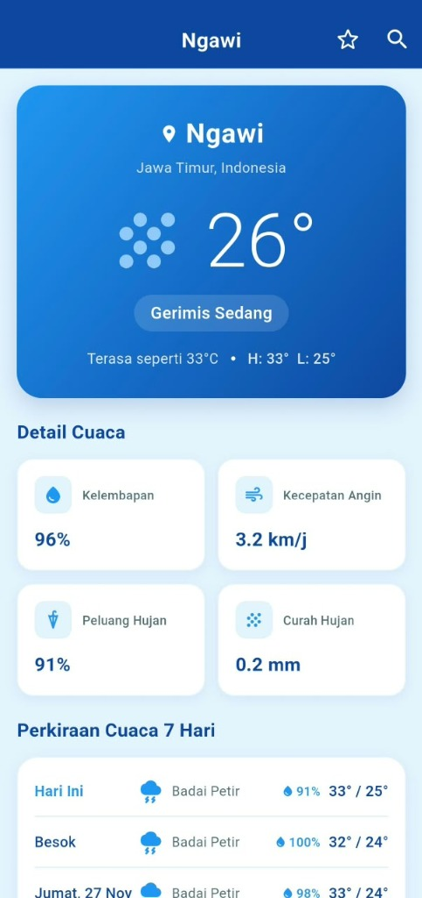
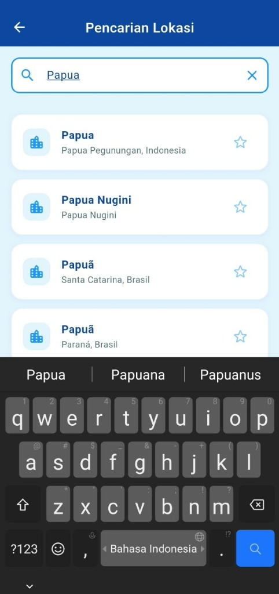
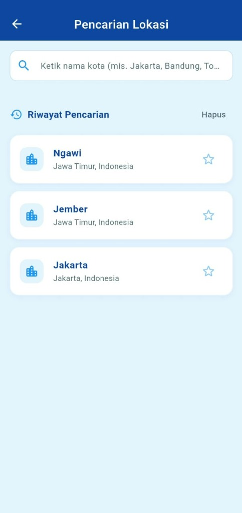

# Responsi Praktikum Pemrograman Mobile - Pawang Cuaca

Aplikasi ramalan cuaca mobile modern berbasis **Flutter** dan **Dart** yang mengintegrasikan **Open-Meteo REST API** secara dinamis dengan menerapkan pola arsitektur **MVVM (Model-View-ViewModel)** dan penyimpanan lokal (**SharedPreferences**).

---

## Gambaran Umum & Fitur Utama

- **Pencarian Kota Real-time:** Pencarian nama kota secara global menggunakan Open-Meteo Geocoding API yang dilengkapi teknik *debounce (450ms)* untuk efisiensi request.
- **Informasi Cuaca Terkini Lengkap:**
  - Suhu saat ini (°C) & Suhu yang dirasakan (*apparent temperature*)
  - Rentang suhu maksimum & minimum hari ini
  - Kondisi cuaca dengan deskripsi bahasa Indonesia dan ikon representatif (WMO weather code)
  - Parameter atmosfer: Kelembapan udara (%), Kecepatan angin (km/j), Peluang hujan (%), dan Curah hujan (mm).
- **Perkiraan Cuaca 7 Hari:** Menampilkan ramalan harian (Hari Ini, Besok, hari-hari berikutnya) beserta peluang hujan dan rentang temperatur.
- **Penyimpanan Lokal (Local Storage):**
  - Menyimpan lokasi favorit (bookmark bintang) yang dapat ditambah/dihapus.
  - Menyimpan riwayat pencarian terakhir (otomatis tersimpan dan dapat dibersihkan).
  - Menyimpan lokasi terakhir yang dipilih pengguna sehingga langsung tampil saat aplikasi dibuka kembali.
- **Penanganan State Komprehensif:** Menangani kondisi *Initial*, *Loading* (indikator progres), *Empty* ("Kota tidak ditemukan"), dan *Error* (penanganan offline/koneksi putus dengan tombol Coba Lagi).
- **Tema & Desain Konsisten:** Material 3 dengan palet warna biru sesuai spesifikasi:
  - Blue 50 (`#E3F2FD`)
  - Blue 200 (`#90CAF9`)
  - Blue 500 (`#2196F3`)
  - Blue 900 (`#0D47A1`)

---

## 📸 Screenshot Tampilan Aplikasi

| Home Screen (Cuaca Terkini & 7 Hari) | Search Screen (Hasil Pencarian API) | Search Screen (Riwayat & Favorit) |
| :---: | :---: | :---: |
|  |  |  |

---

## Struktur Folder Proyek

Struktur kode diatur rapi memisahkan tanggung jawab (Separation of Concerns) sesuai panduan arsitektur MVVM:

```text
lib/
├── main.dart                          # Inisialisasi app, dependency injection & MultiProvider
├── core/
│   ├── theme/
│   │   └── app_theme.dart             # Konfigurasi Material 3 Theme & ColorScheme palet biru
│   └── utils/
│       └── weather_code_mapper.dart   # Pemetaan WMO weather_code ke teks & ikon Material
├── models/
│   ├── location_model.dart            # Model data kota (id, koordinat, nama, negara, favorit)
│   ├── weather_model.dart             # Model data cuaca terkini & metrik hari ini
│   └── daily_forecast_model.dart      # Model data prakiraan harian 7 hari
├── services/
│   ├── geocoding_service.dart         # HTTP service ke Open-Meteo Geocoding API
│   ├── weather_service.dart           # HTTP service ke Open-Meteo Forecast API
│   └── local_storage_service.dart     # Service SharedPreferences (favorit, riwayat, sesi)
├── repositories/
│   └── weather_repository.dart        # Abstraksi data layer menjembatani Service & ViewModel
├── viewmodels/
│   ├── weather_viewmodel.dart         # State & logika presentasi layar cuaca utama
│   └── search_viewmodel.dart          # State & logika pencarian kota, favorit, riwayat
└── views/
    ├── home_screen.dart               # Tampilan layar utama cuaca
    ├── search_screen.dart             # Tampilan layar pencarian kota & bookmark
    └── widgets/
        ├── current_weather_card.dart  # Kartu gradien cuaca terkini
        ├── weather_detail_item.dart   # Kartu metrik kelembapan, angin, hujan
        ├── daily_forecast_tile.dart   # Daftar perkiraan cuaca 7 hari
        └── location_tile.dart         # Komponen item kota dengan toggle favorit
```

---

## Implementasi API Open-Meteo

Seluruh data cuaca dan pencarian lokasi diambil secara **real-time** melalui Open-Meteo API (tanpa data hardcoded):

### 1. Geocoding API (Pencarian Lokasi)
- **Endpoint:** `GET https://geocoding-api.open-meteo.com/v1/search`
- **Parameter:**
  - `name`: nama kota yang dicari
  - `count`: `10`
  - `language`: `id`
  - `format`: `json`
- **Contoh Respons:**
  ```json
  {
    "results": [
      {
        "id": 1629001,
        "name": "Purwokerto",
        "latitude": -7.4244,
        "longitude": 109.2303,
        "country": "Indonesia",
        "admin1": "Jawa Tengah",
        "timezone": "Asia/Jakarta"
      }
    ]
  }
  ```

### 2. Forecast API (Data Cuaca Terkini & Harian)
- **Endpoint:** `GET https://api.open-meteo.com/v1/forecast`
- **Parameter:**
  - `latitude`: koordinat lintang
  - `longitude`: koordinat bujur
  - `current`: `temperature_2m,relative_humidity_2m,apparent_temperature,precipitation,weather_code,wind_speed_10m`
  - `daily`: `weather_code,temperature_2m_max,temperature_2m_min,precipitation_probability_max`
  - `timezone`: `auto`
  - `forecast_days`: `7`
- **Contoh Respons:**
  ```json
  {
    "current": {
      "temperature_2m": 28.4,
      "relative_humidity_2m": 78,
      "apparent_temperature": 32.1,
      "precipitation": 0.0,
      "weather_code": 2,
      "wind_speed_10m": 8.5
    },
    "daily": {
      "time": ["2026-11-25", "2026-11-26"],
      "weather_code": [2, 61],
      "temperature_2m_max": [31.2, 30.0],
      "temperature_2m_min": [23.1, 22.8],
      "precipitation_probability_max": [25, 80]
    }
  }
  ```

---

## Penerapan Arsitektur MVVM

Aplikasi ini menerapkan standar arsitektur **MVVM (Model-View-ViewModel)** secara ketat:
1. **Model & Data Layer (`models/`, `services/`, `repositories/`):**
   - Menangani struktur data, serialisasi JSON, request HTTP ke Open-Meteo, serta penyimpanan ke local storage.
   - Bersifat independen terhadap View dan ViewModel.
2. **ViewModel Layer (`viewmodels/`):**
   - Menggunakan `ChangeNotifier` dari Flutter foundation.
   - Tidak mengimpor `BuildContext` maupun widget UI.
   - Mengelola status antarmuka melalui `ViewState` (`initial`, `loading`, `success`, `empty`, `error`).
   - Menerima aksi pengguna dari View, memproses data melalui Repository, lalu memberi tahu View melalui `notifyListeners()`.
3. **View Layer (`views/`):**
   - Berisi antarmuka pengguna (`HomeScreen`, `SearchScreen`, dan custom widgets).
   - Menampilkan UI berdasarkan state terkini ViewModel menggunakan `Consumer` dan `context.watch`.
   - Tidak pernah melakukan pemanggilan HTTP API langsung dari widget.

---

## State Management & Local Storage

- **State Management:** Menggunakan **Provider** (`ChangeNotifierProvider`, `MultiProvider`, `Consumer`).
- **Local Storage:** Menggunakan **SharedPreferences** untuk:
  - Menyimpan daftar lokasi favorit (`favorite_locations`).
  - Menyimpan riwayat pencarian kota (`search_history`).
  - Menyimpan kota terakhir yang dipilih pengguna (`last_selected_location`).

---

## Cara Menjalankan Proyek

1. **Clone repository:**
   ```bash
   git clone <URL_REPOSITORY_ANDA>
   cd responsi_pawangcuaca
   ```

2. **Unduh dependencies:**
   ```bash
   flutter pub get
   ```

3. **Jalankan pengujian unit:**
   ```bash
   flutter test
   ```

4. **Jalankan aplikasi:**
   ```bash
   flutter run
   ```

---

## Link Video Penjelasan Kode

- **Link Video:** *[Video Penjelasan](https://youtu.be/wwzKEtg-UOg)*
